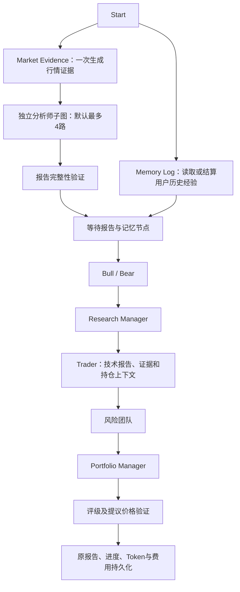

# Agent 证据结构升级与默认最大并发

本轮在 dev 上延续前一轮的 SaaS 执行升级，重点让各角色基于相同证据工作。新 Runner 任务使用 workflow v3；已有执行清单中的 v1/v2 保持原节点拓扑，旧 Checkpoint 缺少清单时继续采用原串行路径。独立 CLI/programmatic `propagate` 也会保存执行清单后启动，避免默认值变化导致恢复时改变图形状。

## 默认并发

- 新任务默认分析师并发为 **4**，即当前支持的最大值；不足四位分析师时按实际人数运行。Worker、API、Python 配置和 `.env.example` 的默认值一致。
- 缺少 `request_concurrency` 的模型配置默认容量也为 4；已明确设置的模型容量、管理员 Worker 任务数、用户任务数、RPM、超时和重试预算仍生效。显式容量为 1 的模型仍按 1 调用。
- 可继续用 `STOCKDEPTH_ANALYST_CONCURRENCY=1|2|4` 覆盖。部署环境中已有的显式环境值不会被代码覆盖；旧任务按清单保存的并发恢复。
- 此次调整的是分析师并发，不会把管理员设置的任务并发扩大为无限或提高供应商明确限额。

## 新执行结构



行情证据通过原配置的数据供应商读取 OHLCV，再按分析截止日过滤、排序、去重并排除无效收盘价。快照包含来源说明、ticker、截止日、实际最新 bar 日期、收盘价、近期五根 bar，以及样本足够时的 SMA20/50/200、简单14周期 RSI/ATR。指标算法明确标注，不能与 Wilder 平滑指标直接等同。实时模式使用当前日期；普通历史模式按指定日期处理。快照不可用时明确标记，允许研究继续，但不允许捏造数字价格。

所有分析师可读同一快照，Trader 直接读取技术报告和快照；研究经理、风险团队和组合经理也得到相同的决策上下文。机器可读评级/操作字段保持英文，正文继续遵循用户语言选择。快照与记忆失败说明会写入完整报告，仍由原 Worker 同步到 PostgreSQL。

## 工具权限与收尾

v3 的 ticker 和截止日通过 LangGraph `InjectedState` 提供，不再让模型猜测和填写。模型只选择数据窗口、指标等研究参数；执行前保留日期和身份守卫。工具绑定与实际执行节点使用同一组 v3 定义；旧版本保留原参数协议，避免恢复失败。

工具轮次耗尽后，分析师调用未绑定工具的模型完成最后一次报告。历史工具请求与返回值转成普通文本，兼容不接受“无工具但包含工具协议消息”的供应商。若模型仍产生工具请求，保留上一轮的缺失报告兜底。分析师只负责报告证据，取消要求它们输出最终交易指令的提示。

辩论开场明确说明对手尚未发言；未选择/未生成的报告说明为“未提供”，不能当作中性研究结论。三个风险角色也使用明确的开场占位。

## 交易提议与持仓

Trader 的入场价和止损价必须是正数、有限、单个绝对报价；不能使用百分比或区间。最终验证检查可识别的价格字段、无快照却给出数字价格，以及 Buy 提议止损不低于入场价等问题，异常返回 REVIEW。此校验是基础格式与方向检查，不是成交可行性、风险收益率或策略盈利保证。原 PM 判断仍保留，只有校验后的最终评级会公开为决策报告。

持仓是**可选输入**，不会自动读取或假设用户的实盘账户。内部已鉴权 `/api/start` 可传 `portfolio`，Runner 可使用 `--portfolio-file`；输入经过 Pydantic 校验，快照指纹加入恢复身份校验，账户信息改变后不能沿用旧分析。未提供持仓表示未知；明确传入空 `positions` 列表才表示输入快照中无持仓。

```json
{"cash": 10000, "currency": "CNY", "positions": [{"ticker": "MOCK", "quantity": 100, "average_price": 95}]}
```

本轮没有添加持仓前端表单，也没有自动把模拟账户当成实盘持仓。需要接入具体账户时，应在 Worker 的用户鉴权范围内构建该输入。

记忆读取或结算异常只输出错误类型及降级说明，不把供应商错误原文/路径/密钥写入公开报告。已完成的研究不会因记忆失败而整体作废；用户隔离、历史可用日期限制和原持久化逻辑继续生效。

## 验证与边界

新增离线测试覆盖：v3 证据步骤与 1/2/4 并发 Checkpoint 恢复、历史日期与时区、注入参数隐藏和覆盖、最终轮无工具绑定、真实 Market 工厂与工具节点连通、Trader 上下文、价格异常 REVIEW、可选持仓及恢复指纹、记忆失败降级。原 Quick/Deep、价格快照、Worker 报告/用量同步回归仍保留。测试不调用付费模型，行情用本地 fixture。

本轮聚焦执行与 Agent 结构，未新增 SEC/A股/港股历史公告源、Jev 外部筛选服务、自适应辩论或逐角色模型配置；这些需要独立的数据接入、费用计量及质量评测。历史基本面仍遵守前一轮“无法证明披露时点则明确不可用”的策略。

本轮验证结果：Python 356 passed、83 subtests passed，1 个外部服务 integration 用例未运行；Worker/Web 类型检查通过；隔离数据库的 Worker 完整/失败/部分恢复、报告同步、Token/费用精度及租约回归通过。没有付费模型调用。
