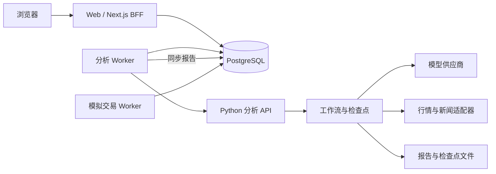

# 功能边界

Web 的浏览器组件放在 `components` 和客户端页面中；需要会话、数据库或支付密钥的代码放在 `lib`、Server Actions 和 HTTP 路由中。浏览器不能直接获取模型 Key。

Python 后端分为 `api`、`agents`、`workflows`、`data`、`providers`。新增供应商适配放入 providers，新增数据源放入 data，流程节点和恢复逻辑归 workflows，角色提示和决策归 agents。现有 CLI 和演示脚本保留作开发工具，不参与网站启动。

Worker 是独立进程，使用数据库任务记录作为持久队列。当前共享的 TypeScript 数据访问和业务模块位于 web/lib，通过 workers/tsconfig.json 显式引用。没有将现有 Server Actions 强行搬迁到 Python，以保留 Next.js 会话与 Stripe 流程。

迁移后，API 与 worker 环境变量统一使用 STOCKDEPTH 前缀，数据目录统一为 ~/.stockdepth。环境名称不影响项目名称；运行环境通过根目录 .env 的 STOCKDEPTH_RUNTIME_BIN 指定。

所有服务配置由根目录 .env 统一加载。模型配置以管理员数据库记录为准，worker 在执行时读取，运行入口不回退到环境中的模型地址或 Key。
