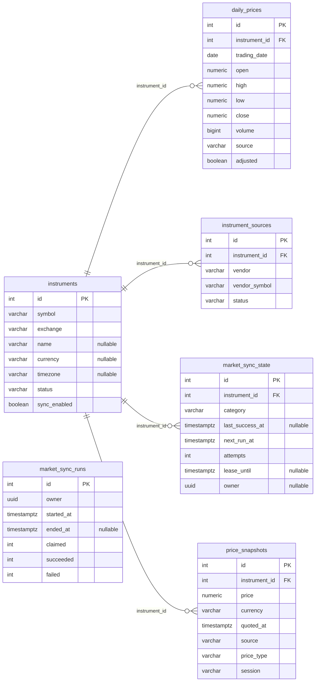
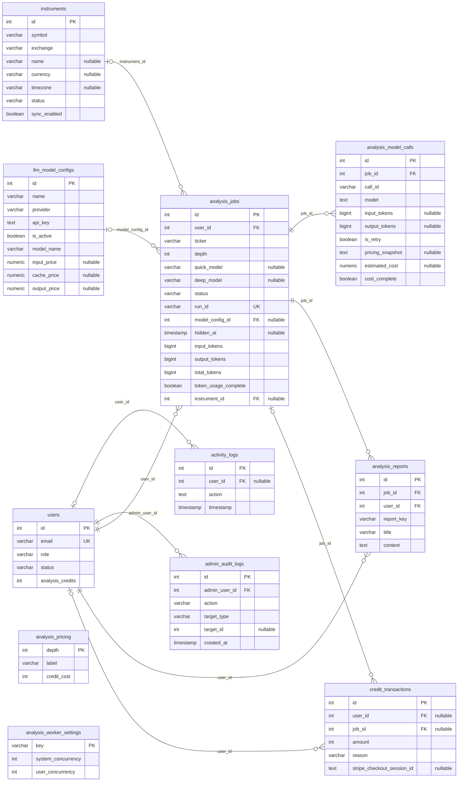
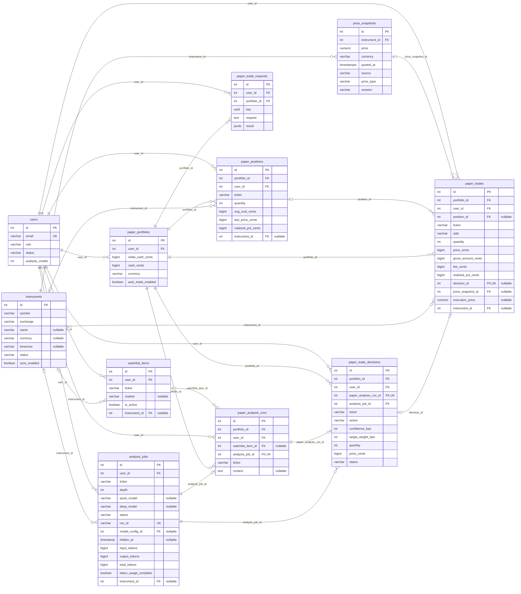

# StockDepth 数据库设计与 ER 图

更新日期：2026-10-13。以当前 PostgreSQL `public` 元数据、`apps/web/lib/db/schema.ts` 和截至 `0029_quiet_virginia_dare.sql` 的迁移为依据。当前共 **23 张业务表、46 个物理外键**，其中 10 个是用户归属/交易范围复合外键。迁移管理表不计入业务表。

系统采用 PostgreSQL + Drizzle ORM。股票目录、供应商映射、报价和日线属于全局共享数据；用户的任务、报告、积分、自选股和模拟资产通过 `user_id` 归属用户。模拟交易记录保存成交价格及报价快照引用，历史成交不会因后续报价刷新而改变。

下方按模块展示主要字段；跨模块实体会重复出现。完整 23 表、全部字段的 Mermaid 源图见 [database-er.mmd](database-er.mmd)。图中 `PK` 为主键，`FK` 为外键，`UK` 只标记单列唯一键；`nullable` 表示可为空。`||` 表示恰好一个，`|o` / `o|` 表示零或一个，`o{` 表示零或多个。复合唯一键与复合外键另列，图中的每条线表示单列物理外键，不表示业务调用关系。

## 共享股票与行情

## 用户、分析、积分与审计

## 自选股、模拟资产与交易

## 表的职责

| 模块 | 表 | 职责 |
| --- | --- | --- |
| 用户与审计 | `users` | 身份、角色、账号状态、积分余额及订阅标识 |
| 用户与审计 | `activity_logs`、`admin_audit_logs` | 用户活动与管理员操作审计；管理员目标是多态字段，不是目标表外键 |
| 分析 | `analysis_jobs` | 持久化任务状态、恢复信息、模型选择快照与汇总 Token |
| 分析 | `analysis_reports` | 任务报告正文和用户归属 |
| 分析 | `analysis_model_calls` | 每次模型调用的 Token、重试状态、计价快照与估算费用 |
| 配置与积分 | `llm_model_configs` | 模型供应商、模型、价格、启用状态；`api_key` 存加密封装，解密密钥在数据库外 |
| 配置与积分 | `analysis_worker_settings`、`analysis_pricing` | 并发配置与分析深度积分价格，两表没有关联任务的物理外键 |
| 配置与积分 | `credit_transactions` | 积分增减流水，可选关联用户和任务；Stripe 会话唯一防重复 |
| 共享行情 | `instruments` | 股票规范身份：交易所 + 代码、币种、时区、身份验证状态、同步开关 |
| 共享行情 | `instrument_sources` | 规范股票与供应商代码的映射 |
| 共享行情 | `price_snapshots` | 带来源、币种、报价时间的不可变价格快照 |
| 共享行情 | `daily_prices` | 按交易日存储 OHLCV，区分来源与是否复权 |
| 共享行情 | `market_sync_state` | 各股票的 identity/quote/daily 同步进度、下次执行时间、租约和重试次数 |
| 共享行情 | `market_sync_runs` | 同步批次统计；`owner` 为 Worker 批次 UUID，不是用户外键，也没有指向同步状态的物理外键 |
| 模拟交易 | `watchlist_items` | 用户自选股，可关联共享股票目录 |
| 模拟交易 | `paper_portfolios` | 用户模拟账户、币种、现金余额及自动交易开关 |
| 模拟交易 | `paper_positions` | 账户持仓、成本、参考价格与已实现盈亏 |
| 模拟交易 | `paper_trades` | 实际模拟成交及费用、盈亏、报价快照和可选 AI 决策引用 |
| 模拟交易 | `paper_trade_requests` | 手工交易幂等请求与结果；结果为 JSONB，没有直接指向成交表的外键 |
| 模拟交易 | `paper_analysis_runs` | 将模拟账户、自选股与分析任务关联 |
| 模拟交易 | `paper_trade_decisions` | AI 交易建议与执行状态；建议价格不是实际成交价格 |

## 关键唯一性与用户隔离

复合唯一键主要包括：

- 股票身份：`instruments(exchange, symbol)`；供应商映射：`instrument_sources(vendor, vendor_symbol)`。
- 报价：`price_snapshots(instrument_id, source, quoted_at, price_type)`；日线：`daily_prices(instrument_id, trading_date, source, adjusted)`；同步状态：`market_sync_state(instrument_id, category)`。
- 自选股：`watchlist_items(user_id, ticker)`；持仓：`paper_positions(portfolio_id, ticker)`。
- 模型调用：`analysis_model_calls(job_id, call_id)`；手工交易幂等：`paper_trade_requests(user_id, portfolio_id, key)`。
- `paper_analysis_runs.analysis_job_id` 唯一，`paper_trade_decisions.paper_analysis_run_id` 唯一，`paper_trades.decision_id` 可空且唯一：一个分析任务最多一个模拟分析运行，一个运行最多一个决策，一个决策最多一笔成交。

账户、任务、自选股等额外提供 `(id, user_id)` 或包含账户/任务的复合唯一键，使以下外键在数据库层校验归属一致，而非只检查对象 ID 是否存在：

| 子表 | 子表字段 | 父表字段 |
| --- | --- | --- |
| `paper_analysis_runs` | `(analysis_job_id, user_id)` | `analysis_jobs(id, user_id)` |
| `paper_analysis_runs` | `(portfolio_id, user_id)` | `paper_portfolios(id, user_id)` |
| `paper_analysis_runs` | `(watchlist_item_id, user_id)` | `watchlist_items(id, user_id)` |
| `paper_positions` | `(portfolio_id, user_id)` | `paper_portfolios(id, user_id)` |
| `paper_trade_decisions` | `(portfolio_id, user_id)` | `paper_portfolios(id, user_id)` |
| `paper_trade_decisions` | `(paper_analysis_run_id, portfolio_id, user_id, analysis_job_id)` | `paper_analysis_runs(id, portfolio_id, user_id, analysis_job_id)` |
| `paper_trade_requests` | `(portfolio_id, user_id)` | `paper_portfolios(id, user_id)` |
| `paper_trades` | `(decision_id, portfolio_id, user_id)` | `paper_trade_decisions(id, portfolio_id, user_id)` |
| `paper_trades` | `(portfolio_id, user_id)` | `paper_portfolios(id, user_id)` |
| `paper_trades` | `(position_id, portfolio_id, user_id)` | `paper_positions(id, portfolio_id, user_id)` |

这些复合外键主要覆盖模拟交易链路。`analysis_reports`、`credit_transactions` 当前仍是分别关联用户与任务的单列外键，没有数据库层的任务所有者复合外键；它们的权限与归属检查仍依赖应用逻辑。

## 金额、报价和约束状态

模拟交易的 10 个 `*_cents` 金额字段使用 PostgreSQL `bigint`，以账户币种的百分之一为单位。应用自定义转换器校验 JavaScript 安全整数范围，计算采用 BigInt 中间值。行情价格和 `execution_price` 使用 `numeric(24,8)`，模型估算费用使用 `numeric(24,12)`，模型单价使用 `numeric(15,6)`。积分是整数，不等同于现金金额。

`price_snapshots` 由数据库触发器禁止 UPDATE/DELETE，保证成交证据稳定。`paper_trades.price_snapshot_id` 当前在结构上允许为空，不能把所有历史成交都理解为已引用报价。多个 `instrument_id` 也允许为空，兼容尚未解析或历史股票记录。

本次实际数据库检查发现 **23 个 `NOT VALID` 约束**：10 个金额安全范围检查、10 个归属复合外键、3 个旧资产检查。它们约束新增或相关更新的数据，但尚未完成历史数据的全量验证；需要审计历史记录后再执行 `VALIDATE CONSTRAINT`，不能据此声称历史数据已完全满足这些约束。

多数单列外键使用默认删除行为；`analysis_model_calls.job_id` 明确使用 `ON DELETE CASCADE`。账号包含 `deleted_at`，任务包含 `hidden_at`；这类隐藏/软删除与物理删除不同。

## 同步数据如何进入共享目录

用户新增股票时，应用幂等创建或复用 `instruments`，并创建需要的同步状态。行情 Worker 以 `sync_enabled` 的股票目录及到期同步状态为工作集，通过租约领取 identity、quote、daily 任务，更新供应商映射、追加报价快照或写入日线，并记录批次结果。用户自选股、任务和资产通过 `instrument_id` 复用这些共享信息。

当前没有单独的实时行情订阅表、外汇汇率表、公司财务指标表或新闻表，也没有独立的总账分录表；图中没有添加未来设想的实体。

## 维护与新机器初始化

表定义位于 [`schema.ts`](../apps/web/lib/db/schema.ts)，迁移位于 [`migrations`](../apps/web/lib/db/migrations)，初始化步骤参照项目 [README](../README.md)。新机器应执行项目迁移流程建立表、索引、外键、检查约束与触发器，不应仅根据 ER 图手工建表。迁移或 schema 改动后需要同步更新本文及完整图。

本文仅记录结构，不包含数据库连接信息、用户数据或密钥值。本次工作没有修改数据库。
